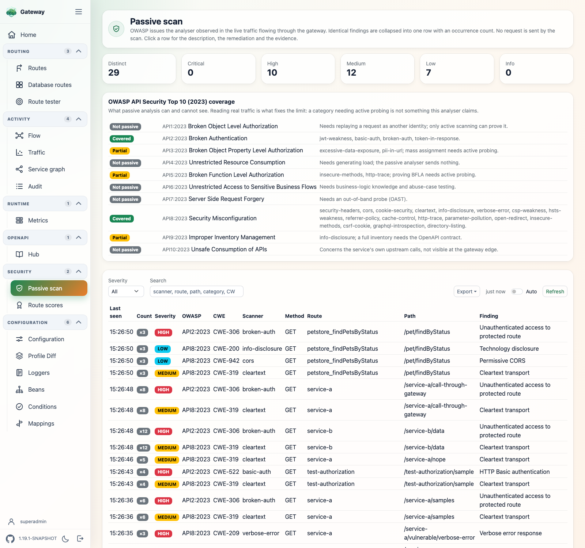
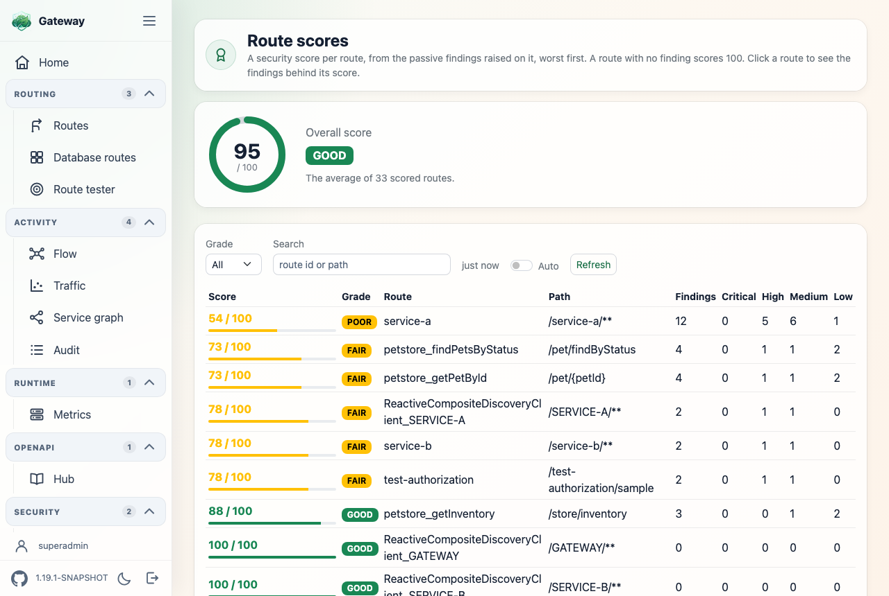

# spring-cloud-gateway-pentest-passive

Passively analyses the request/response traffic flowing through the gateway and reports the
OWASP issues it observes. It generates no traffic of its own — it only reads what real
clients and downstream services exchange — so it is safe to leave running, and it sees the
gateway's own edge (its headers, its CORS, the tokens presented to it).



## Install

```xml
<dependency>
    <groupId>ch.nexsol-tech.gateway</groupId>
    <artifactId>spring-cloud-gateway-pentest-passive</artifactId>
    <version>${spring-cloud-gateway-plugins.version}</version>
</dependency>
```

## Configuration

All properties are under `spring.cloud.gateway.server.webflux.pentest.passive`.

```yaml
spring:
  cloud:
    gateway:
      server:
        webflux:
          pentest:
            passive:
              enabled: true         # off by default: it inspects the routed traffic
              routed-only: true      # only exchanges a route handled; leaves out the console
              max-findings: 500       # distinct findings kept, with an occurrence count each
              body:
                enabled: true         # capture response bodies for the body-aware scanners
                max-bytes: 65536      # bounded, so a large response is truncated
              jwt:
                clock-skew: 60s       # must match the clock skew your token validator allows
              scanners:
                exclude: [ parameter-pollution ]   # ids to skip; empty include runs them all
              security-chain-enabled: true   # the plugin closes /passive-scan/* itself, see "Who may read the findings"
              security:
                user:                 # the local user accepted over HTTP Basic; no password, no local user
                  name: admin
                  password:
                oauth2.resourceserver.jwt:
                  issuer-uri:         # issuer of the Bearer tokens the API accepts
                  audiences: []       # what their aud must carry one of
```

| Property | Default | What it does |
| --- | --- | --- |
| `...passive.enabled` | `false` | Master switch; off because it inspects every routed exchange |
| `...passive.routed-only` | `true` | Inspect only exchanges a gateway route handled — the console, its assets and the actuator are left out |
| `...passive.max-findings` | `500` | How many distinct findings the in-memory store keeps |
| `...passive.queue-capacity` | `1024` | Exchanges awaiting inspection before further ones are dropped |
| `...passive.exclude-paths` | `[/passive-scan/**]` | Request paths never inspected |
| `...passive.scanners.include` | `[]` | Scanner ids to run; empty runs every one |
| `...passive.scanners.exclude` | `[]` | Scanner ids to skip, applied after the include list |
| `...passive.body.enabled` | `false` | Capture response bodies for the body-aware scanners |
| `...passive.body.max-bytes` | `65536` | Largest response body captured, in bytes |
| `...passive.jwt.clock-skew` | `60s` | How long past its `exp` a token is still accepted, for `jwt-weakness` |
| `...passive.security-chain-enabled` | `true` | Whether the plugin contributes its own `SecurityWebFilterChain` over `/passive-scan/*` |
| `...passive.security.user.name` | `admin` | Name of the local user of that chain |
| `...passive.security.user.password` | — | Password of the local user; unset, no local user is declared and Basic is checked against the user directory of the application |
| `...passive.security.user.roles` | `[ADMIN]` | Roles the local user holds |
| `...passive.security.oauth2.resourceserver.jwt.issuer-uri` | — | Issuer whose Bearer tokens the API accepts; unset, the decoder the application declared |
| `...passive.security.oauth2.resourceserver.jwt.audiences` | `[]` | Audiences a token of that issuer must carry one of; empty accepts any token of the issuer |

### Turning it off without a restart

`enabled`, `routed-only` and the two `body` properties are read on every exchange, so
changing them in the config server and calling `/actuator/refresh` — or `/actuator/busrefresh`
for every instance at once — takes effect on the next request:

```bash
curl -X POST http://localhost:8181/actuator/refresh
```

`enabled: false` stops the analysis immediately, including for exchanges already in flight;
the findings already collected stay readable. The remaining properties — `max-findings`,
`queue-capacity`, `exclude-paths` and the scanner selection — size beans built at startup and
need a restart.

`enabled` must be `true` at startup for the plugin to be wired at all: a refresh toggles the
analysis, it cannot create the beans. Run with it on and turn it off when you are done, or
leave it off and restart the day you need it.

## What it scans

Findings map to the OWASP API Security Top 10 and carry a CWE, a description and a
remediation. Identical findings — same scanner, method, route, path and title — collapse
into one, with an occurrence count. Most scanners read metadata only and are always active;
the two body-aware ones run only when `body.enabled` is `true`.

A finding names the endpoint, not the request: the path is reduced to its template before
being stored, so `/users/ann@acme.com/invoices` is recorded as `/users/{id}/invoices`.
Whatever a caller puts in a path — an address, a card number, a reset token — therefore
never reaches the store, the export or Redis, and a caller cannot create an unbounded
number of distinct findings by varying the path.

The route is part of what makes a finding distinct because the template alone does not
identify the endpoint. A segment longer than 24 characters, or carrying a digit and longer
than 8, is read as a value — which is what a service name looks like on a gateway routing
by service name: `/v3/api-docs/API-GATEWAY-INTERNAL-SERVICE` and
`/v3/api-docs/CONFIGSERVER-3` both reduce to `/v3/api-docs/{id}`. Keying on the route as
well keeps them apart, and costs nothing in cardinality: a route id comes from the
gateway's own route table, never from the caller.

| Scanner | CWE | Looks for |
| --- | --- | --- |
| `security-headers` | CWE-693 | Missing `X-Content-Type-Options`, HSTS, and CSP/`X-Frame-Options` on HTML; successful responses only |
| `cors` | CWE-942 | A wildcard origin, or an origin reflected back with credentials |
| `cookie-security` | CWE-1004 | Cookies without `HttpOnly`, `Secure`, `SameSite` |
| `cleartext` | CWE-319 | Traffic over plain HTTP (honours `X-Forwarded-Proto`) |
| `sensitive-query` | CWE-598 | Secrets in the URL (`token`, `password`, …) |
| `jwt-weakness` | CWE-347 / CWE-613 | `alg=none`, a missing `exp`, or one elapsed beyond `jwt.clock-skew`, on tokens the gateway accepted |
| `http-trace` | CWE-693 | A successful `TRACE`/`TRACK` |
| `parameter-pollution` | CWE-235 | A repeated query parameter |
| `info-disclosure` | CWE-200 | `Server`/`X-Powered-By` version disclosure |
| `verbose-error` | CWE-209 | A stack trace or internal error leaked in the body of an error response |
| `excessive-data-exposure` | CWE-359 | Private keys, password fields, bulk e-mails in the body |
| `csp-weakness` | CWE-1021 | A CSP weakened by `unsafe-inline`/`unsafe-eval`/wildcard |
| `hsts-weakness` | CWE-319 | HSTS present but with no usable `max-age`, one under a year, or no `includeSubDomains` |
| `referrer-policy` | CWE-200 | HTML response with no or `unsafe-url` Referrer-Policy |
| `cache-control` | CWE-525 | Authenticated/cookie response not marked uncacheable |
| `basic-auth` | CWE-522 | HTTP Basic authentication, critically over cleartext |
| `insecure-methods` | CWE-650 | `Allow` advertises PUT/DELETE/PATCH/TRACE |
| `open-redirect` | CWE-601 | A 3xx whose `Location` is an external host from a request param |
| `pii-in-url` | CWE-359 | An e-mail, or a Luhn-valid card number carrying an issuer identifier, in the URL |
| `csrf-cookie` | CWE-352 | A cookie-authenticated mutation with no CSRF token |
| `token-in-response` | CWE-522 | A JWT or secret field in the response body |
| `graphql-introspection` | CWE-200 | A GraphQL `__schema` introspection response |
| `directory-listing` | CWE-548 | An auto-generated directory listing |

Inspection runs off the request hot path on a single worker fed by a bounded queue: the
filter never blocks, and exchanges beyond the queue capacity are dropped rather than grown
in memory.

## OWASP API Security Top 10 (2023) coverage

Passive analysis reads real traffic; it never sends a probe. That fixes what it can and
cannot see. It covers the misconfiguration and authentication categories well, some of the
others partially, and cannot reach the categories that require actively exercising the API.

| Category | Coverage | By |
| --- | --- | --- |
| API2 Broken Authentication | Good | `jwt-weakness`, `basic-auth`, `broken-auth`, `token-in-response` |
| API8 Security Misconfiguration | Good | headers, `cors`, `cookie-security`, `cleartext`, `info-disclosure`, `verbose-error`, `csp-weakness`, `hsts-weakness`, `referrer-policy`, `cache-control`, `http-trace`, `parameter-pollution`, `open-redirect`, `insecure-methods`, `csrf-cookie`, `graphql-introspection`, `directory-listing` |
| API3 Broken Object Property Level Authz | Partial | `excessive-data-exposure`, `pii-in-url` (mass assignment needs active probing) |
| API5 Broken Function Level Authz | Partial | `insecure-methods`, `http-trace` (proving BFLA needs active probing) |
| API9 Improper Inventory Management | Partial | `info-disclosure` |
| API1 BOLA | Not passively | needs replaying a request as another identity |
| API4 Unrestricted Resource Consumption | Not passively | needs generating load |
| API6 Unrestricted Access to Sensitive Business Flows | Not passively | needs business-logic knowledge |
| API7 Server Side Request Forgery | Not passively | needs an out-of-band probe |
| API10 Unsafe Consumption of APIs | Not passively | concerns the service's own upstream calls |

## Route scores

Every route gets a security score from the distinct findings raised on it, so the worst
routes surface first. A route with no finding scores 100.

The score starts at 100 and drops with diminishing returns: within one severity the first
distinct finding costs the full weight — critical 30, high 15, medium 7, low 3, info 1 —
and each further one half of the previous, so a severity never costs more than twice its
weight. The grade follows the score: **Good** ≥ 80, **Fair** ≥ 60, **Poor** ≥ 40, **Bad**
below. Exchanges no route handled are grouped under `(unrouted)`.

- `GET /passive-scan/routes` — the scores as JSON, worst first
- The console renders them under **Security → Route scores**, filterable by grade, route id
  and path.



### Matching your token validator

`jwt-weakness` reports an expired token only once it is expired by more than
`jwt.clock-skew`. That mirrors Spring Security: `JwtTimestampValidator` rejects a token only
when `now - clockSkew` is after `exp`, so it accepts one for that long past its expiry on
purpose, and reporting inside that window contradicts the validator on traffic it had every
reason to serve — with nothing in the logs to corroborate the finding.

The token is judged as it was when the request arrived, not when the analyser got to it. The
difference matters for a long-lived exchange: a server-sent-events subscription is one request
that stays open for as long as the client listens, so its token routinely expires mid-stream
even though it was valid when the gateway admitted it. Only a token already expired at
admission is reported.

The default, `60s`, is Spring Security's own. If you build your validator with a different
skew, set this property to the same value:

```java
new JwtTimestampValidator(Duration.ofMinutes(2))   // then jwt.clock-skew: 2m
```

## Cross-plugin enrichment

Present on the classpath, other plugins light up extra behaviour, with no dependency
declared towards them:

- **routes-security** — the `broken-auth` scanner (CWE-306) is added, flagging a successful
  response to a route not marked `public` that carried no bearer token.
- **metrics** (Micrometer) — every finding is counted under `gateway.passive.scan.findings`,
  tagged by severity and category.

## Reports

The findings are kept in memory only. The console API exports them on demand, and nothing is
written to disk:

- `GET /passive-scan/findings` — the findings as JSON
- `GET /passive-scan/summary` — the counts of the distinct findings
- `GET /passive-scan/export?format=sarif|json|html` — a downloadable report; SARIF feeds a CI
  code-scanning pipeline and carries the occurrence count per result
- `POST /passive-scan/findings/clear` — discard the retained findings

With [spring-cloud-gateway-ui](../../spring-cloud-gateway-ui/README.md) on the classpath, the
console shows a live view under `/ui/passive-scan`, in the **Security** menu group.

## Who may read the findings

The findings are an inventory of the weaknesses of the gateway, `/passive-scan/export` hands
the whole of it over in one call and `/passive-scan/findings/clear` erases it. When Spring
Security is active, the plugin contributes its own `SecurityWebFilterChain` asking for an
authenticated principal on every path above, CSRF off since they are called with a token.
Two credentials pass:

| Credential | Validated against |
| --- | --- |
| HTTP Basic | the local user of the API, `...passive.security.user`, held by this chain alone; without a password, the user directory of the application: `spring.security.user`, or the `ReactiveUserDetailsService` it declares |
| Bearer token | `...passive.security.oauth2.resourceserver.jwt.issuer-uri`, with `...audiences` when the token must have been issued for this gateway; unset, the `ReactiveJwtDecoder` the application declared, if any |

```yaml
spring.cloud.gateway.server.webflux.pentest.passive.security:
  user:
    name: auditor
    password: "{bcrypt}$2a$10$..."    # a clear-text value is encoded at start-up
  oauth2.resourceserver.jwt:
    issuer-uri: https://your-idp.example.com/realms/master
    audiences: [https://gateway.example.com/passive-scan]
```

The issuer is asked for its keys on the first token that arrives, never at start-up. Bearer
needs `spring-security-oauth2-jose` and `spring-security-oauth2-resource-server` on the
classpath, which this plugin does not bring: without them the chain answers Basic alone. Two
conditions keep this plugin from making a gateway *less* safe by being added to it:

* **It backs off when no other `SecurityWebFilterChain` exists.** Spring Security serves its
  own "everything authenticated" chain as long as there is none, and that chain already covers
  these paths. Replacing it with one matching the analyser alone would leave every other path
  unguarded.
* **It backs off when there is nothing to authenticate against** — no local user or issuer
  above, and no user directory, authentication manager or issuer in the application. A blank
  value is no value.

The chain is ordered at `PassiveScanSecurityAutoConfiguration.PASSIVE_SCAN_CHAIN_ORDER`
(`Ordered.HIGHEST_PRECEDENCE + 375`), behind the one the console contributes. Two escape
hatches: declare your own bean named `passiveScanSecurityWebFilterChain`, or set
`security-chain-enabled: false`.

**With the console.** The module declares its paths through a `SecuredPaths` bean from
[`spring-cloud-gateway-commons`](../../spring-cloud-gateway-commons/README.md): the findings
follow [the mode of the console](../../spring-cloud-gateway-ui/README.md#the-endpoints-of-the-other-plugins),
the purge always asks for a principal. Its chain is ordered ahead of the one above, so a
gateway carrying the console has a single place deciding who reaches what.

## Sample

[gateway-passive-scan](../../spring-cloud-gateway-samples/gateway/gateway-passive-scan/README.md)
— port `8214`.
