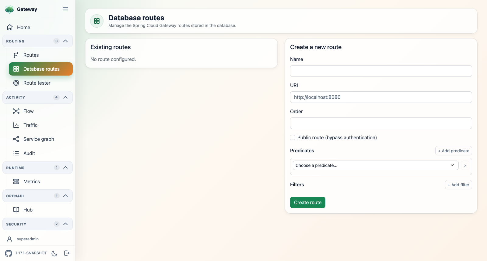

# spring-cloud-gateway-routes-database

Stores route definitions in a relational database (R2DBC) and aggregates them into the route
locator. Routes are managed through a REST API, and through the view the
[console](../../spring-cloud-gateway-ui/README.md) renders over them.

Unlike the other sources, this one is not cached: it reads on demand, so it always reflects
the latest state.

## Install

```xml
<dependency>
    <groupId>ch.nexsol-tech.gateway</groupId>
    <artifactId>spring-cloud-gateway-routes-database</artifactId>
    <version>${spring-cloud-gateway-plugins.version}</version>
</dependency>
```

## Configuration

All properties are under `spring.cloud.gateway.server.webflux.routes-database`.

```yaml
spring.cloud.gateway.server.webflux.routes-database:
  # Unwires the plugin entirely: no locator, no services, no endpoints.
  enabled: true
  # What is published over HTTP — never where the routes come from.
  access: read-only
  # Set to false to keep the plugin from contributing its own security chain.
  security-chain-enabled: true
  # What that chain authenticates against on a gateway without a console, see
  # "Who may change the routes". Unset, whatever the application declared.
  security:
    user:
      name: admin
      password:
    oauth2.resourceserver.jwt:
      issuer-uri:
      audiences: []
```

| Property | Default | What it does |
| --- | --- | --- |
| `...routes-database.enabled` | `true` | Is the plugin there at all; `false` stops the database feeding the gateway |
| `...routes-database.access` | `unrestricted` | What is published: `unrestricted`, `read-only`, `none` |
| `...routes-database.security-chain-enabled` | `true` | Whether the plugin contributes its own `SecurityWebFilterChain` |
| `...routes-database.security.user.name` | `admin` | Name of the local user of that chain |
| `...routes-database.security.user.password` | — | Password of the local user; unset, no local user is declared and Basic is checked against the user directory of the application |
| `...routes-database.security.user.roles` | `[ADMIN]` | Roles the local user holds |
| `...routes-database.security.oauth2.resourceserver.jwt.issuer-uri` | — | Issuer whose Bearer tokens the API accepts; unset, the decoder the application declared |
| `...routes-database.security.oauth2.resourceserver.jwt.audiences` | `[]` | Audiences a token of that issuer must carry one of; empty accepts any token of the issuer |

Whatever `access` is set to, **the database keeps feeding the gateway its routes**. It governs
what is published over HTTP, not where the routes come from.

| `access` | Effect |
| --- | --- |
| `unrestricted` | Everything: read and write |
| `read-only` | Routes can be listed and read; anything that would change one answers `405 Method Not Allowed`, and the view drops the buttons leading there |
| `none` | No endpoint at all: the controllers are not registered and the view does not appear |

`read-only` is the answer available to a gateway that has no authentication to offer: routes
arriving by migration can be published for reading with every change refused, without
authenticating anybody.

## REST API

A reactive API under `/api/gateway/routes`: CRUD on route definitions at runtime, each route
carrying its predicates and its filters in the same form the gateway configuration uses.

## Management view

The page over these routes belongs to the
[console](../../spring-cloud-gateway-ui/README.md#database-routes-view), served at
`/ui/routes/db`: this plugin holds the routes, the console renders them. Add
`spring-cloud-gateway-ui` and the view lights up with a **Database routes** entry in the side
menu; without it, this plugin exposes its REST API alone.



## Who may change the routes

Reaching this API, or that page, reconfigures the routing table. When Spring Security is
active, the plugin contributes its own `SecurityWebFilterChain` asking for an authenticated
principal on its API. CSRF is off on that chain, since everything it matches is called with a
token and a JSON body by a client holding no session. Two credentials pass:

| Credential | Validated against |
| --- | --- |
| HTTP Basic | the local user of the API, `...routes-database.security.user`, held by this chain alone; without a password, the user directory of the application: `spring.security.user`, or the `ReactiveUserDetailsService` it declares |
| Bearer token | `...routes-database.security.oauth2.resourceserver.jwt.issuer-uri`, with `...audiences` when the token must have been issued for this gateway; unset, the `ReactiveJwtDecoder` the application declared, if any |

```yaml
spring.cloud.gateway.server.webflux.routes-database.security:
  user:
    name: operator
    password: "{bcrypt}$2a$10$..."    # a clear-text value is encoded at start-up
  oauth2.resourceserver.jwt:
    issuer-uri: https://your-idp.example.com/realms/master
    audiences: [https://gateway.example.com/api/gateway/routes]
```

The issuer is asked for its keys on the first token that arrives, never at start-up. Bearer
needs `spring-security-oauth2-jose` and `spring-security-oauth2-resource-server` on the
classpath, which this plugin does not bring: without them the chain answers Basic alone. Two
conditions keep this plugin from making a gateway *less* safe by being added to it:

* **It backs off when no other `SecurityWebFilterChain` exists.** Spring Security serves its
  own "everything authenticated" chain as long as there is none, and that chain already covers
  these paths. Replacing it with one matching route management alone would leave every other
  path unguarded.
* **It backs off when there is nothing to authenticate against** — no local user or issuer
  above, and no user directory, authentication manager or issuer in the application. A blank
  value is no value. Such a
  gateway closes these endpoints with `access` instead.

The chain is ordered at `GatewayDatabaseSecurityAutoConfiguration.ROUTE_MANAGEMENT_CHAIN_ORDER`
(`Ordered.HIGHEST_PRECEDENCE + 350`), behind the one the console contributes. Two escape
hatches: declare your own bean named `routeManagementSecurityWebFilterChain`, or set
`security-chain-enabled: false`.

**With the console.** The module declares its API through a `SecuredPaths.api(...)` bean from
[`spring-cloud-gateway-commons`](../../spring-cloud-gateway-commons/README.md), as endpoints
that change the gateway — so the console asks for a principal on them whether or not it is
itself open, under `...ui.security.write-mode`. Its chain is ordered ahead of the one above,
so a gateway carrying the console has a single place deciding who reaches what. See
[the console's README](../../spring-cloud-gateway-ui/README.md#the-endpoints-that-change-the-gateway).

## Sample

[gateway-routes-all](../../spring-cloud-gateway-samples/gateway/gateway-routes-all/README.md)
— port `8210`, with PostgreSQL on `15432`.
